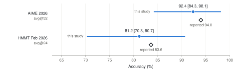
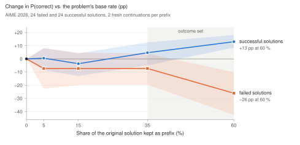
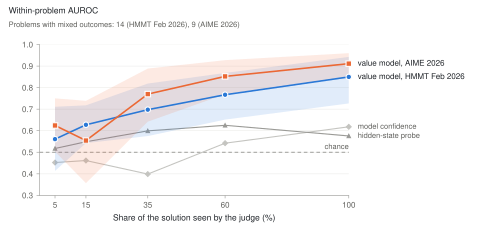
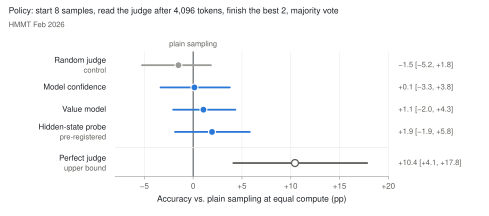

# Limite-1B-Violetto: reproduction and a value-model study

Independent experiments on [Limite-1B-Violetto](https://huggingface.co/paradigma-inc/limite-1b-violetto), Paradigma's
1B-parameter math reasoning model, and its released
[value model](https://huggingface.co/paradigma-inc/limite-1b-value-model).

The study first reproduces two reported benchmark results. It then asks one question about the long solutions the
model writes: **when is the outcome of a solution decided, and when can the value model see it?**

**Summary**

- **The reported numbers reproduce.** AIME 2026: 92.4 % avg@32 (reported 94.0 %). HMMT Feb 2026: 81.2 % avg@24
  (reported 83.6 %). Both reported values lie inside our 95 % intervals.
- **A solution is decided in its second half.** Restarting a solution from its first 35 % gives about the same
  chance of success as a fresh sample, whether the original solution was right or wrong. By 60 %, the outcome is
  largely set.
- **The value model knows late.** Among solutions to the same problem, its AUROC is close to chance early on and
  reaches 0.85 (HMMT) and 0.91 (AIME) on the finished solution.
- **Early pruning does not save compute yet** (pre-registered). Judging 8 samples after 4,096 tokens and finishing
  the best 2 gives +1.9 pp over plain sampling at equal compute, with a CI of −1.9 to +5.8 pp. A perfect judge in the
  same policy would give +10 pp.

## 1. Reproduction

<p align="center"></p>

| Benchmark | Samples per problem | This repository (`exact`, 95 % CI) | Reported ([1], Table 5) |
|---|---|---|---|
| AIME 2026 (30 problems) | 32 | **92.40 %** (84.3–98.1) | 94.01 % |
| HMMT Feb 2026 (33 problems) | 24 | **81.19 %** (70.3–90.7) | 83.62 % |

AIME 2026 was run with the unmodified upstream harness ([`limite-violetto`](https://github.com/paradigma-inc/limite-violetto)
@ `7ddad34`, `uv sync --locked`, all defaults). HMMT Feb 2026 uses the harness's taskset, prompt rendering, sampling
profile, seeds and graders, generated with this repository's script so that every token is available for the study
below. Problems, reference answers and the `exact` grader come from MathArena [8]; they are not redistributed
here. The intervals are bootstrap intervals over problems. Details: [docs/reproduction.md](docs/reproduction.md).

## 2. When is a solution decided?

The experiment takes 48 stored AIME 2026 solutions (24 failed, 24 successful) from the problems the model does not
always solve. Each solution is cut after 5, 15, 35 or 60 % of its tokens, and the model writes two fresh
continuations from each cut. Comparing each prefix's success rate with its problem's base rate shows how much the
prefix has already decided.

<p align="center"></p>

Up to 35 %, prefixes of failed and of successful solutions are about as good as a fresh start: −7 pp (95 % CI −20
to +4) for failed and +5 pp (−5 to +13) for successful solutions. At 60 % the paths have split: −26 pp (−42 to −10)
for failed and +13 pp (+9 to +18) for successful solutions, and all 48 continuations of successful prefixes are
correct. **The outcome is set between 35 % and 60 % of a solution.**

## 3. When does the value model know?

The value model gives V(prompt, response so far) at every token. The measure is how well it ranks winning above
losing solutions **to the same problem**, after it has seen a given share of each solution. This is a within-problem
AUROC, averaged over the problems with mixed outcomes: 14 on HMMT and 9 on AIME.

<p align="center"></p>

On HMMT Feb 2026 the AUROC is 0.56 / 0.63 / 0.70 / 0.77 / 0.85 after 5 / 15 / 35 / 60 / 100 % of a solution. On
AIME 2026 it is 0.62 / 0.55 / 0.77 / 0.85 / 0.91. Counted in tokens, it is near chance for the first 8k tokens on
both sets. Early values mostly encode how hard the problem is: across problems, the value already separates
correct from wrong solutions (AUROC 0.58–0.68 after 0.5k–8k tokens on the development pool), but within a problem
it does not. A linear probe
on Limite's hidden states and Limite's own token confidence stay well below the value model. The value model follows
the commitment curve of section 2 closely: it becomes informative once the solution has committed, and not before.

## 4. Can early judging save compute?

The policy is pre-registered: it was fixed before any HMMT Feb 2026 sample was generated and before any judge was
evaluated (see [docs/preregistration.md](docs/preregistration.md)).
It starts 8 samples, reads a judge after 4,096 tokens, finishes only the best 2 and takes a majority vote. It is
compared with plain majority voting at the same number of generated tokens, counting every stopped prefix. The judge
was chosen on a separate, decontaminated development pool (4,000 rollouts), and the policy is simulated exactly on
the stored HMMT Feb 2026 samples.

<p align="center"></p>

The pre-registered judge (a hidden-state probe) gives **+1.9 pp (95 % CI −1.9 to +5.8)**, so the criterion "CI
above zero" is not met. The value model gives +1.1 pp (−2.0 to +4.3), and a random judge gives −1.5 pp (−5.2 to
+1.8), which shows that the policy itself is unbiased. A perfect judge at the same checkpoint would give **+10.4 pp
(+4.1 to +17.8)**: the headroom is real, but the early signal is missing. AIME 2026 is close to saturated
(maj@16 = 96.7 %); there, every judge lands between −2.7 and −0.4 pp in the same setting.

## 5. The value model as a verifier (exploratory)

Since the value model is accurate on finished solutions, a natural use is to pick the best of k finished samples.
This analysis was not pre-registered.

| k | HMMT Feb 2026: best-of-k by value vs majority of k | AIME 2026 |
|---|---|---|
| 2 | 84.6 vs 82.1 % (+2.5 pp, CI +0.7 to +4.4) | 95.0 vs 93.2 % (+1.7 pp, CI +0.7 to +2.9) |
| 4 | 86.6 vs 85.1 % (+1.5 pp, CI −1.8 to +5.1) | 96.0 vs 95.6 % |
| 8 | 87.6 vs 86.8 % | 96.5 vs 96.5 % |
| 16 | 87.6 vs 88.6 % | equal |

The gain is clearest at small k and fades as the majority vote gets stronger.

## Setup

| | |
|---|---|
| Model | `paradigma-inc/limite-1b-violetto` @ `b1f3d572` (the checkpoint pinned by the harness), chat profile (T = 0.6, top-p 0.95), native budget 126,976 tokens |
| Value model | `paradigma-inc/limite-1b-value-model` @ `ce83740e`, V(prompt, response[:t]) before every token |
| Other judges | Limite's own token statistics (log-prob, entropy, DeepConf top-20 confidence over the last 512 tokens); a ridge probe on Limite's hidden states, fitted on the development pool only |
| Development pool | 2,000 problems × 2 samples from DeepScaleR, NuminaMath-1.5 and MATH (levels 3–5), decontaminated against every harness evaluation set, 16k-token cap, Math-Verify labels |
| Hardware | AIME reproduction: one A100-40GB (4.7 h). Everything else: one RTX PRO 6000 Blackwell 96 GB per job (11.8 GPU-hours in total; smoke tests on an L4) |
| Generated tokens | 116M in total (AIME 29M, HMMT 36M, restarts 16M, development pool 35M) |
| Statistics | bootstrap over problems (10,000 resamples); within-problem AUROC; policies averaged over 200 random sample orders per problem |

The full tables (all judges, all policy settings, compute per job) are in [docs/results.md](docs/results.md), and
every number is in `results/`.

## Reproduce

CPU part (tests, analysis of stored runs, figures):

```bash
python3 -m venv .venv && . .venv/bin/activate
pip install -e ".[dev,figures]"
pytest -q
python scripts/make_figures.py          # figures/ from results/
```

GPU part: Linux, NVIDIA driver with CUDA ≥ 13. `gpu/setup.sh` clones the upstream harness and installs its locked
environment.

```bash
bash gpu/aime26_reproduction.sh                                         # AIME 2026, avg@32
python scripts/analyze_reproduction.py work/limite-violetto/limite-evals/outputs/eval/full-aime26-avg32-<stamp> \
    --env work/env --out results/reproduction/aime26.json

MODE=dev RUN=work/runs/dev bash gpu/value_study.sh                      # development pool
python scripts/prepare_inputs.py --out work/inputs \
    --aime-samples work/limite-violetto/limite-evals/outputs/eval/full-aime26-avg32-<stamp>/metrics/samples.jsonl \
    --dev-rollouts work/runs/dev/data/rollouts.jsonl
MODE=parity RUN=work/runs/parity bash gpu/value_study.sh                # attention check (gate)
MODE=judges RUN=work/runs/judges bash gpu/value_study.sh                # judges on AIME 2026 + dev pool
MODE=branch RUN=work/runs/branch bash gpu/value_study.sh                # restarts from prefixes
MODE=hmmt START=0  END=17 RUN=work/runs/hmmt-1 bash gpu/value_study.sh  # HMMT Feb 2026 x 24 + judges
MODE=hmmt START=17 END=33 RUN=work/runs/hmmt-2 bash gpu/value_study.sh

python scripts/analyze_value_study.py --runs work/runs/{judges,branch,hmmt-1,hmmt-2} --inputs work/inputs \
    --out results/value_model
python scripts/controls.py work/runs/hmmt-1 work/runs/hmmt-2 > results/value_model/controls.json
```

The scripts in `gpu/` are cleaned, portable versions of the job scripts used for the runs. The commands they run,
and the Python scripts they call, are unchanged. The CPU analysis reproduces every number in `results/` exactly from
the stored runs.

The raw rollouts (116M generated tokens) are not part of this repository. This study's branch job ran in two parts
because of a time limit (seed bases 50,000,000 and 60,000,000; see the pre-registration); one job with the default
seed base is statistically equivalent.

## Layout

```
gpu/                 GPU jobs: environment, AIME 2026 reproduction, value-model study
scripts/             generation and judging (value_study.py), inputs, analysis, controls, figures
src/limite_experiments/
  stats.py           bootstrap, within-problem AUROC
  selection.py       judges, majority vote, the early-selection policy (exact offline simulation)
  probe.py           ridge probe, problem-grouped folds
  dev_pool.py        deduplication and decontamination
  third_party/limite Limite model code by Paradigma (Apache-2.0; the five files in PROVENANCE.md are unmodified)
tests/               CPU tests (statistics, policy simulation, decontamination, checksums of the vendored files)
results/             every reported number (JSON)
figures/             the figures above (SVG)
docs/                reproduction details, pre-registration, full results
LICENSE, NOTICE      Apache-2.0 and third-party attributions; CITATION.cff for citing
```

## Limitations

- **Small numbers of informative problems.** The within-problem statistics rest on the problems with mixed outcomes
  (14 on HMMT, 9 on AIME), and the commitment curve on 48 solutions with 2 continuations per point. Effects of a
  few points are below the resolution of this study.
- **The probe was chosen on little data.** The pre-registered primary judge was picked on only 23 development pairs
  at 4k tokens, so "probe" was close to a coin flip. All judges are reported.
- **Scope.** The commitment curve covers AIME 2026 only, and HMMT Feb 2026 uses 24 instead of 32 samples (both were
  compute decisions made before any data).
- **Precedent.** Related methods exist: confidence-filtered early stopping (DeepConf [5]), Monte Carlo prefix
  values (Math-Shepherd [6]) and resampling of reasoning steps (Thought Anchors [7]). This study applies such
  measurements to Paradigma's model and critic, with exact compute accounting against full reproductions.

## References

1. Paradigma. *Limite-1B-Violetto* technical report.
   [paradigma.inc/research/limite-1b-violetto.pdf](https://paradigma.inc/research/limite-1b-violetto.pdf)
2. Limite-1B-Violetto model weights. [huggingface.co/paradigma-inc/limite-1b-violetto](https://huggingface.co/paradigma-inc/limite-1b-violetto)
3. Limite value model. [huggingface.co/paradigma-inc/limite-1b-value-model](https://huggingface.co/paradigma-inc/limite-1b-value-model)
4. `limite-violetto` serving code and evaluation harness. [github.com/paradigma-inc/limite-violetto](https://github.com/paradigma-inc/limite-violetto)
5. Y. Fu et al. *Deep Think with Confidence.* 2025. [arXiv:2508.15260](https://arxiv.org/abs/2508.15260)
6. P. Wang et al. *Math-Shepherd: Verify and Reinforce LLMs Step-by-step without Human Annotations.* 2023.
   [arXiv:2312.08935](https://arxiv.org/abs/2312.08935)
7. P. C. Bogdan, U. Macar et al. *Thought Anchors: Which LLM Reasoning Steps Matter?* 2025.
   [arXiv:2506.19143](https://arxiv.org/abs/2506.19143)
8. M. Balunović et al. *MathArena: Evaluating LLMs on Uncontaminated Math Competitions.* 2025.
   [arXiv:2505.23281](https://arxiv.org/abs/2505.23281), [matharena.ai](https://matharena.ai)

## License

Apache-2.0 ([LICENSE](LICENSE), [NOTICE](NOTICE)). `src/limite_experiments/third_party/limite/` contains
Apache-2.0 code by Paradigma, unmodified (see its PROVENANCE.md). The model, value model, harness and datasets are
downloaded at run time under their own licences. This is independent work, not affiliated with or endorsed by Paradigma; thanks to
Paradigma for releasing the model, the value model and the evaluation harness openly.

## Citation

```bibtex
@misc{seitzer2026limitevalue,
  author = {Seitzer, Felix},
  title  = {Limite-1B-Violetto: reproduction and a value-model study},
  year   = {2026},
  url    = {https://github.com/Felix561/limite-1b-math-experiments}
}
```

---

<sub>AI-generated banner, with visual inspiration from [Paradigma](https://paradigma.inc/). Independent project; not affiliated with or endorsed by Paradigma.</sub>
